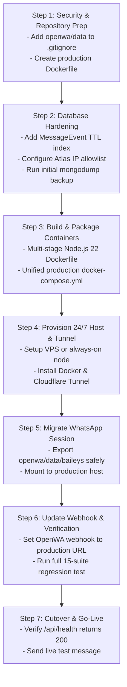

# DHUSHYANDH AI — Production Deployment Plan

**Version**: 1.0  
**Phase**: Phase 5 Production Infrastructure & Launch  
**Goal**: Transition DHUSHYANDH AI from local workstation to a reliable 24/7 production runtime at ₹0 additional cost.

---

## 1. Executive Strategy & Target Architecture

To satisfy the **₹0 initial additional software cost** requirement while achieving genuine 24/7 availability, DHUSHYANDH AI will be deployed using a **Cloudflare Tunnel + Dedicated Cloud VPS / Always-On Host** architecture.

```
                           [Internet / WhatsApp]
                                     │
                                     ▼
                        [OpenWA Baileys Container]
                                     │
               Internal Docker Network: dhushyandh-ai-net
                   HTTP POST /api/webhooks/openwa (HMAC)
                                     │
                                     ▼
                         [Node.js 22 Express API]
                          (Production Container)
                                     │
         ┌───────────────────────────┴───────────────────────────┐
         ▼                                                       ▼
[MongoDB Atlas Cloud]                                  [Google Gemini API]
Replica Set (WiredTiger)                               Primary + Fallback
Atlas M0 (Encrypted in transit)                        Rate-limited, Bounded
```

---

## 2. Recommended Hosting Options

### Option A: Oracle Cloud Always Free (Recommended — 100% Free Cloud)
- **Specs**: 4 Ampere ARM vCPUs, 24 GB RAM, 200 GB NVMe storage, 10 TB/month outbound bandwidth, fixed IPv4.
- **Cost**: **₹0 / month forever**.
- **Architecture**: Single Ubuntu 24.04 ARM instance running Docker Compose with `openwa` and `api` services inside an isolated Docker bridge network.
- **Ingress**: Cloudflare Tunnel (`cloudflared`) providing free SSL/TLS termination and DDoS mitigation to `api.dhushyandh.in`.

### Option B: Dedicated Local Mini PC / Home Server (Alternative Zero-Cost Option)
- **Specs**: Any dedicated always-on mini PC (e.g. Intel N100, Raspberry Pi 4/5, or repurposed laptop with battery backup).
- **Cost**: **₹0 software cost** (~₹100–₹150/month electricity).
- **Ingress**: Cloudflare Tunnel exposing `localhost:5000` securely without port-forwarding on router.
- **Advantage**: Instant setup, keeps Baileys session local.

### Option C: Low-Cost Production VPS (Paid Fallback Option)
- **Specs**: Hetzner Cloud CX22 (€3.79/mo ~ ₹350/mo) or AWS Lightsail ($3.50/mo ~ ₹300/mo).
- **Advantage**: Guaranteed 99.9% uptime SLA, professional hosting environment.

---

## 3. Production Deployment Sequence (Step-by-Step)



### Phase 1: Repository & Codebase Hardening (Pre-Deployment)
1. **Secure `.gitignore`**:
   Add `openwa/data/` immediately to prevent committing session tokens, SQLite databases, and operator secrets.
2. **Containerize API Server**:
   Write a production-grade multi-stage `Dockerfile` for `apps/api`:
   - Non-root user (`node`).
   - Minimal base image (`node:22-alpine`).
   - Production dependencies only (`npm ci --only=production`).
   - Healthcheck instruction verifying `/api/health`.
3. **Unified Production Docker Compose**:
   Create a single `docker-compose.prod.yml` running:
   - `openwa`: Gateway service with persistent session volume.
   - `api`: Express API connected via internal Docker bridge network (`dhushyandh-ai-net`).
   - `cloudflared`: Lightweight tunnel daemon providing secure HTTPS ingress.
4. **Implement Missing Reliability Patches**:
   - Add TTL index (e.g. 30–60 days) to `MessageEvent` to prevent unbounded Atlas storage growth.
   - Add watchdog recovery for reminders stuck in `status: "sending"`.
   - Add Mongoose connection event listeners (`error`, `disconnected`, `reconnected`).

### Phase 2: Host Provisioning & Network Setup
1. **Server Setup**: Provision Ubuntu 24.04 LTS on the target host (Oracle Cloud Always Free or dedicated local node).
2. **Docker Installation**: Install Docker Engine and Docker Compose v2.
3. **Atlas Network Access**: Add target host public IP (or allowlist `0.0.0.0/0` with strong MongoDB Atlas credentials and SCRAM-SHA-256 authentication).
4. **Cloudflare Tunnel Deployment**:
   - Route `api.dhushyandh.in` (or tunnel hostname) directly to `http://api:5000`.
   - Enable HTTPS-only, TLS 1.3, and Cloudflare WAF.

### Phase 3: Session Migration & Cutover
1. **WhatsApp Session Transfer**:
   - Gracefully stop local OpenWA container: `docker compose down`.
   - Safely copy `openwa/data/baileys/` to the production host `/app/data/baileys/`.
   - Verify permissions on production host: `chown -R 1000:1000 data/`.
2. **Update OpenWA Webhook Endpoint**:
   - In production Docker network, OpenWA communicates directly with Express via container DNS:
     `http://api:5000/api/webhooks/openwa` (internal, zero latency, no public roundtrip!).
3. **Run Validation Suite**:
   - Execute regression tests against production endpoints (`/api/health`).
   - Send live test message from owner account (`/menu`, `/tasks`).
   - Send live test message from visitor account (`Who is Dhushyandh?`).

---

## 4. Backup & Disaster Recovery Strategy

### 4.1 Automated Database Backup Routine
Since MongoDB Atlas M0 Free Tier lacks continuous automated snapshots, a cron-based backup script will run daily on the host:

```bash
#!/bin/bash
# scripts/backup-mongodb.sh
TIMESTAMP=$(date +%Y%m%d_%H%M%S)
BACKUP_DIR="/backups/mongodb/$TIMESTAMP"
mkdir -p "$BACKUP_DIR"

# Run mongodump
mongodump --uri="$MONGODB_URI" --gzip --out="$BACKUP_DIR"

# Keep last 14 days of backups
find /backups/mongodb -mindepth 1 -maxdepth 1 -type d -mtime +14 -exec rm -rf {} +
```

### 4.2 WhatsApp Session Backup
- The `openwa/data/baileys/` directory contains active session keys.
- If the host filesystem corrupts, re-authentication requires scanning the QR code again.
- **Weekly Session Snapshot**: Tar and encrypt `openwa/data/baileys/` to local backup storage.

### 4.3 Recovery Time Objective (RTO) & Recovery Point Objective (RPO)
- **RTO (Target Time to Recover)**: < 15 minutes.
- **RPO (Maximum Data Loss Window)**: < 24 hours for knowledge/leads; 0 seconds for database (Atlas replica set guarantees durability).

---

## 5. Risks and Mitigations

| Risk | Impact | Likelihood | Mitigation |
| :--- | :---: | :---: | :--- |
| **WhatsApp Linked Device Logout** | High | Medium | Healthcheck triggers automated alert if status != `ready`. Re-scan QR code via web dashboard. |
| **MongoDB Atlas Quota Exceeded (512MB)** | High | Low | Add 30-day TTL index on `MessageEvent` collection; compress historical logs. |
| **Gemini API Transient Outage** | Medium | Medium | Automated dual-model fallback (`gemini-3.8-flash` ➔ `gemini-3.5-flash-lite`) already implemented and tested. |
| **Docker Host Power Outage** | High | Low/Medium | Use Oracle Cloud Always Free (99.9% uptime) or UPS-backed hardware for local node. |
| **OpenWA Memory Leak** | Medium | Medium | Container `mem_limit: 1g` and healthcheck restart policy prevents runaway memory consumption. |

---

## 6. Implementation Rollout Checklist

- [ ] Add `openwa/data/` to `.gitignore`.
- [ ] Create `apps/api/Dockerfile` (multi-stage, non-root).
- [ ] Create `docker-compose.prod.yml` with internal bridge network.
- [ ] Add `expiresAt` TTL index to `message-event.model.js`.
- [ ] Add stale recovery logic to `reminder.service.js`.
- [ ] Add Mongoose connection event listeners to `database.js`.
- [ ] Add `express-rate-limit` to `app.js` for webhook intake.
- [ ] Setup Cloudflare Tunnel for secure HTTPS ingress.
- [ ] Test production startup and verify all 85 tests pass.
- [ ] Migrate Baileys session and perform live cutover.
